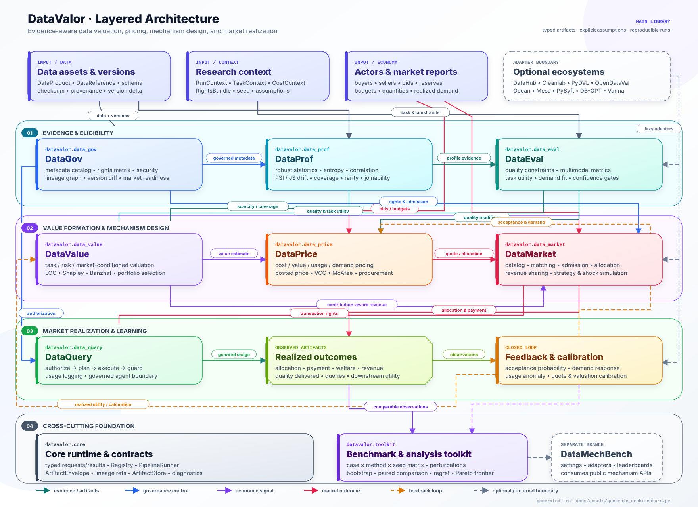

# DataValor

**Data valuation, pricing, and market mechanisms in one Python toolkit**

DataValor 可以登记数据资产，检查来源、权利和质量，计算任务效用与数据贡献，生成报价，并运行拍卖、采购、匹配和收益分配机制。所有步骤使用统一的数据产品、运行上下文和版本化 artifact，因此一次实验中的数据、估值、报价、配置与支付可以连续追踪。

仓库同时提供 Python API 和可视化工作台：研究者可以比较估值、定价和机制设计方法；数据提供方与采购方可以批量选择资产和参与者，配置方法，运行市场过程并查看完整结果。

## 项目目标

同一份数据进入真实业务后，往往要先回答“从哪里来、能不能用、质量怎样”，再回答“对这项任务值多少、应该报什么价、由谁买到以及怎样支付”。这些问题通常散落在数据治理、机器学习、定价和市场系统中，实验对象和结果也很难接起来。

DataValor 的主要目标，是把这条链路整理成一套可执行的 Python 接口：数据资产只登记一次，治理证据、质量结果、任务效用、估值、报价、配置、支付和使用反馈都绑定到同一资产及其版本。这样既可以单独研究一种估值或机制，也可以把多个环节组合起来，比较方法变化最终会怎样影响交易结果。

当前重点是服务数据估值、定价和机制设计研究，并让小到中等规模的实验能够在工作台中直接运行和检查。它已经是一套可以使用和扩展的研究代码库；面向持续运营、大规模数据与多租户生产环境的平台化能力，还需要后续开发逐步补齐。

## 主要功能

- 登记数据资产、来源、Schema、许可条件和市场参与者；
- 对表格、文本、图像、音频、视频和多模态数据执行画像与质量评估；
- 使用任务效用、反事实、风险调整、Shapley 等方法估值和归因；
- 按成本、价值、质量、时效、权利、需求或订阅模式生成价格；
- 运行拍卖、预算采购、组合匹配、支付和收益分配等市场配置机制；
- 保存参数、随机种子、运行记录、产物谱系与使用反馈；
- 通过工作台完成多资产、多买方和多卖方的批量实验。

## 后续开发

下一阶段会沿着“研究流程规模化”和“工作台平台化”两条线继续推进。这里列的是目前最值得投入的方向，而不是已经完成的能力清单。

- **更大规模的执行。** 将批量估值、定价和市场仿真拆为可恢复的异步任务，支持并行执行、增量计算、失败重试和资源配额；把当前适合实验的数据与产物存储扩展为数据库、对象存储和缓存组合。
- **更完整的平台能力。** 完善组织、项目、角色和资产级权限，增加审计记录、凭据管理、任务队列、运行监控和服务化部署，使多个团队可以在彼此独立的工作区中长期使用。
- **持续接入真实资产。** 增加数据库、数据湖、对象存储、特征平台和数据目录 adapter，并让大文件以引用、抽样和统计摘要参与计算，避免在工作台内重复搬运完整数据。
- **从实验结果走向运营反馈。** 继续建设成交后的许可执行、用量计量、收益结算、质量漂移监控和再定价，让一次性实验能够延伸为可观察的市场运行周期。
- **方法与机制扩展。** 保持组件注册接口稳定，继续引入数据估值、隐私定价、组合采购、多边市场与动态机制等研究实现，并提供统一的输入检查和结果解释。

这些工作会优先复用现有的 `DataProduct`、artifact 谱系和组件注册体系。规模化和平台化需要依靠后续持续开发，并随着数据量、任务量和使用团队增长逐步引入上述基础设施。

## 研究范围与术语

DataValor 将数据价值链拆为若干语义不同的研究对象，并在代码和实验报告中分别记录。

| 研究对象 | 含义 | DataValor 中的主要产物 |
|---|---|---|
| 数据治理（data governance） | 数据来源、权利、用途限制、血缘和安全条件 | `GovernanceReport`、`RightsEvaluation`、`GovernanceAuditBundle` |
| 数据画像（data profiling） | 字段分布、缺失、基数、相关性、漂移与市场可用性等描述性事实 | `DatasetProfile`、`DriftReport` |
| 数据质量与任务效用（data quality and task utility） | 数据在指定维度或下游任务上的观测表现 | `EvaluationReport`、`TaskUtilityResult` |
| 数据估值（data valuation） | 给定买方、任务、成本与市场条件时的数据效用或货币价值估计 | `ValuationReport`、`ValueEstimate` |
| 数据贡献归因（data contribution attribution） | 数据单元、群组或来源对联盟效用的边际贡献 | `ContributionReport` |
| 数据定价（data pricing） | 基于成本、价值、需求、质量、权利或市场参照形成的报价 | `PriceQuote` |
| 机制结果（mechanism outcome） | 在报告出价、保留价和约束下形成的配置、支付与福利 | `PricingOutcome` |
| 市场实现（market realization） | 挂牌、匹配、交易、收益分配、策略响应和使用反馈 | `MarketSnapshot`、`SimulationReport`、`UsageAggregate` |

`RunContext`、`TaskContext`、`CostContext` 与 `RightsBundle` 分别记录估值、报价、支付和有限轮仿真的条件，使各类结果能够按其假设解释和复现。

## Benchmark 分支

数据估值与定价机制的系统评测框架 DataMechBench 已从 `main` 分离，完整代码保存在仓库的 [`benchmark` 分支](https://github.com/OpenDIV-Lab/DataValor/tree/benchmark/benchmark)。该分支包含 benchmark 的 setting、机制适配器、指标、runner、来源证据、测试和文档。

```bash
git clone --branch benchmark https://github.com/OpenDIV-Lab/DataValor.git
cd DataValor/benchmark
```

`main` 分支承载 DataValor Python library；`src/datavalor/toolkit/benchmark` 提供通用数据源、扰动、实验矩阵和结果接口。DataMechBench 的榜单与完整评测流程位于 `benchmark` 分支。

## 分层架构

DataValor 使用版本化 artifact 连接数据治理、证据构建、估值、报价、机制结果与真实使用反馈。实线表示主库内部的数据、控制或经济信号，虚线表示反馈回路或 optional adapter 接入；DataMechBench 作为独立分支只消费主库公共 API。

<p align="center">
  
</p>

图由 [`docs/assets/generate_architecture.py`](docs/assets/generate_architecture.py) 在本地生成；修改模块或关系后运行 `python docs/assets/generate_architecture.py` 即可更新 SVG。字体栈采用 Inter、系统 UI 字体、Segoe UI 和 sans-serif 回退，配色按证据构建、价值形成、市场机制和使用反馈分组。

## 与相关开源项目的功能范围比较

下表按各项目官方仓库中作为一等接口提供的可执行能力统计。包含多个术语的列以其中一种核心能力为准：`✅` 表示仓库提供对应实现，`—` 表示该能力未列为主要实现。比较基于 2026-10-20 可访问的官方文档与仓库。

| 项目 | 治理、权利与血缘 | 画像与质量 | 任务效用 | 估值与贡献归因 | 定价模型 | 拍卖与预算采购 | 匹配与收益分配 | 策略市场仿真 | 查询与使用反馈 | 实验矩阵与统计比较 |
|---|:---:|:---:|:---:|:---:|:---:|:---:|:---:|:---:|:---:|:---:|
| **DataValor** | ✅ | ✅ | ✅ | ✅ | ✅ | ✅ | ✅ | ✅ | ✅ | ✅ |
| [OpenDataVal](https://github.com/opendataval/opendataval) | — | ✅ | ✅ | ✅ | — | — | — | — | — | ✅ |
| [pyDVL](https://github.com/aai-institute/pyDVL) | — | — | ✅ | ✅ | — | — | — | — | — | — |
| [DataPerf](https://github.com/mlcommons/dataperf) | — | ✅ | ✅ | — | — | — | — | — | — | ✅ |
| [Ocean.py](https://github.com/oceanprotocol/ocean.py) | ✅ | — | — | — | ✅ | — | — | — | ✅ | — |
| [data.all](https://github.com/data-dot-all/dataall) | ✅ | — | — | — | — | — | — | — | ✅ | — |
| [DataHub](https://github.com/datahub-project/datahub) | ✅ | ✅ | — | — | — | — | — | — | — | — |
| [Data-Juicer](https://github.com/datajuicer/data-juicer) | — | ✅ | — | — | — | — | — | — | — | — |
| [PyMarket](https://github.com/kiedanski/pymarket) | — | — | — | — | — | ✅ | ✅ | ✅ | — | ✅ |
| [NegMAS](https://github.com/yasserfarouk/negmas) | — | — | — | — | — | ✅ | — | ✅ | — | — |
| [DB-GPT](https://github.com/eosphoros-ai/DB-GPT) | — | — | — | — | — | — | — | — | ✅ | — |

下表直接统计上面的二元矩阵。能力类型分为数据基础（治理、画像、质量与任务效用）、价值归因、定价与机制、使用环节、实验分析五类；统计口径为功能范围，代码规模、成熟度和实验性能需结合各项目的具体实现判断。

| 项目 | 能力覆盖数（共 10 项） | 覆盖率 | 类型覆盖数（共 5 类） | 主要覆盖类型 |
|---|:---:|:---:|:---:|---|
| **DataValor** | **10** | **100%** | **5** | 数据基础、价值归因、定价与机制、使用环节、实验分析 |
| OpenDataVal | 4 | 40% | 3 | 数据基础、价值归因、实验分析 |
| pyDVL | 2 | 20% | 2 | 数据基础、价值归因 |
| DataPerf | 3 | 30% | 2 | 数据基础、实验分析 |
| Ocean.py | 3 | 30% | 3 | 数据基础、定价与机制、使用环节 |
| data.all | 2 | 20% | 2 | 数据基础、使用环节 |
| DataHub | 2 | 20% | 1 | 数据基础 |
| Data-Juicer | 1 | 10% | 1 | 数据基础 |
| PyMarket | 4 | 40% | 2 | 定价与机制、实验分析 |
| NegMAS | 2 | 20% | 1 | 定价与机制 |
| DB-GPT | 1 | 10% | 1 | 使用环节 |

DataValor 的优势在于把这些分散在专项项目中的能力纳入同一套可组合 Python 契约和版本化 artifact 链路，使治理证据、任务效用、估值、报价、机制结果与实际使用反馈能够在同一实验中追踪和比较。

<details>
<summary>比较依据（官方仓库与文档）</summary>

- [OpenDataVal README](https://github.com/opendataval/opendataval#readme)、[pyDVL README](https://github.com/aai-institute/pyDVL#readme) 与 [DataPerf challenges](https://github.com/mlcommons/dataperf#dataperf-2023-challenges)；
- [Ocean.py 交易流程](https://github.com/oceanprotocol/ocean.py/blob/main/READMEs/main-flow.md) 与 [data.all README](https://github.com/data-dot-all/dataall#readme)；
- [DataHub 功能概览](https://github.com/datahub-project/datahub/blob/master/docs/features.md) 与 [Data-Juicer quickstart](https://github.com/datajuicer/data-juicer/blob/main/docs/tutorial/QuickStart.md)；
- [PyMarket README](https://github.com/kiedanski/pymarket#readme)、[NegMAS README](https://github.com/yasserfarouk/negmas#readme) 与 [DB-GPT README](https://github.com/eosphoros-ai/DB-GPT#readme)。

</details>

## 包结构

```text
DataValor/
├── src/datavalor/
│   ├── core/                  # 数据产品、运行上下文、artifact、registry、pipeline
│   ├── data_gov/              # 来源、权利、血缘、安全与治理判断
│   ├── data_prof/             # 统计画像、漂移与市场相关描述量
│   ├── data_eval/             # 质量指标、任务效用与多模态评估
│   ├── data_value/            # 任务估值、贡献归因、校准与组合选择
│   ├── data_price/            # 报价模型、拍卖、采购与支付机制
│   ├── data_market/           # 挂牌、匹配、收益分配与有限市场仿真
│   ├── data_query/            # 权利约束查询、结果防护与使用反馈
│   └── toolkit/               # 通用 benchmark、统计分析与 Web UI 接口
├── configs/                   # 工作流和集成配置
├── data/examples/             # 小型可提交样例
├── examples/                  # 可直接运行的研究示例
├── tests/                     # 主库测试
├── UI/                        # 场景化批量估值、定价与市场工作台
└── docs/                      # 架构、接口和研究说明
```

## 已实现的方法

以下按公共 API 与源码模块列出代表性实现，包括但不限于这些算法、机制、指标和适配器。

### Core：实验对象与可追溯执行

`datavalor.core` 定义各模块共享的稳定契约：

- `DataProduct`、`DataReference`、`RightsBundle`：描述数据、内容校验、schema 和使用权利；
- `ActorProfile`、`TaskContext`、`CostContext`、`RunContext`：显式记录参与者、任务、成本和随机种子；
- `ArtifactEnvelope[T]`、`ArtifactRef`、`ArtifactStore`：保存版本、producer、lineage、evidence 与 diagnostics；
- `Registry[T]`、`ComponentSpec`：提供带 capability 和可选依赖的延迟组件注册；
- `PipelineSpec`、`PipelineRunner`：运行有依赖关系的估值定价工作流。

### DataGov：治理、权利与血缘

| 类别 | 已实现的方法或组件 |
|---|---|
| 元数据与目录 | `LocalMetadataExtractor`、`InMemoryMetadataCatalog`；CSV、JSON、JSONL、Parquet、Directory 与 Iterable adapter |
| 权利判断 | `RightsPolicyEvaluator`、`RightsMatrixEvaluator`、`rights_intersection`、`rights_expiry_window` |
| 安全检查 | `SensitiveFieldScanner`、`GreatExpectationsPolicyEvaluator`、`DeequPolicyEvaluator` |
| 血缘分析 | `LineageGraph`、`trace_upstream`、`trace_downstream`、`affected_artifacts`、`compare_lineage` |
| 版本分析 | `MetadataDiff`、`compare_metadata_records`、`compare_products`、`requires_re_evaluation` |
| 市场准入 | `RightsRestrictivenessScorer`、`RightsCompatibilityEvaluator`、`ArtifactStalenessEvaluator` |
| 外部适配器 | DataHub、OpenMetadata、Great Expectations、PyDeequ、PySyft |

### DataProf：统计画像与分布变化

| 类别 | 已实现的方法或指标 |
|---|---|
| 基础画像 | `BasicProfileMetric`、`BasicDataProfiler`、`BasicProfileComparator` |
| 稳健统计 | 分位数、IQR、变异系数和 Tukey 异常围栏（`RobustStatisticsMetric`） |
| 类别分布 | Shannon entropy、Gini concentration、top-k coverage（`CategoricalConcentrationMetric`） |
| 变量关系 | Pearson correlation（`PairwiseCorrelationMetric`） |
| 分布漂移 | 数值 PSI、类别 Jensen–Shannon divergence（`DriftAnalyzer`） |
| 市场相关画像 | `CoverageProfileMetric`、`RarityProfileMetric`、`FreshnessProfileMetric`、`JoinabilityMetric`、`CrossProductOverlapAnalyzer` |
| 数据抽样 | 固定随机种子的比例分层抽样 `stratified_sample` |

### DataEval：数据质量与任务效用

| 数据形态或问题 | 已实现的方法或指标 |
|---|---|
| 通用质量 | `CompletenessMetric`、`DuplicateRateMetric`、`FieldValidityMetric`、`CompositeEvaluator` |
| 业务约束 | `NumericRangeComplianceMetric`、`LabelConflictMetric`、`GroupCompletenessParityMetric`、`EvaluationThresholdGate` |
| 表格数据 | schema consistency、数值统计、IQR outlier rate、label balance |
| 文本数据 | length、lexical diversity、repetition rate、readability |
| 图像数据 | metadata quality、aspect-ratio consistency、pixel validity |
| 音频数据 | metadata quality、clipping rate、silence rate |
| 视频数据 | format probe、optical-flow motion、scene segmentation、temporal SSIM、privacy CV score |
| 多模态数据 | package integrity、cross-modal alignment |
| 任务效用 | `RecordCountUtility`、`CallableTaskUtility`、`DemandFitEvaluator`、`EvaluationConfidenceEstimator` |
| 外部适配器 | Cleanlab、Evidently、Great Expectations、TorchMetrics |

每个 `MetricResult` 都保留 `dimension`、`scope`、`direction`、`unit`、`statistics`、`evidence` 和 `diagnostics`。指标方向支持 higher-is-better、lower-is-better、target-is-best 与 descriptive。

### DataValue：任务估值与贡献归因

#### 任务与市场条件估值

| 方法族 | 已实现的方法 |
|---|---|
| 可解释任务估值 | `WeightedUserTaskValuator`、`SymbolicValuator` |
| 学习型估值 | `LearnedLinearValuator` |
| 质量与情景估值 | `QualityAdjustedValuator`、`ScenarioValuator` |
| 风险与反事实 | `RiskAdjustedValuator`、`CounterfactualValuator` |
| 组合价值 | `PortfolioValuator`、`BudgetConstrainedPortfolioSelector` |
| 市场条件估值 | `MarketContextValuator`、`ScarcityAdjustedValuator`、`IncrementalCoverageValuator`、`SubstitutionAdjustedValuator` |
| 时间与更新 | `TimeDecayValuator`、`UpdateStreamValuator` |
| 集成与敏感性 | `ValuationEnsemble`、`ConsensusValuation`、`ValuationSensitivityAnalyzer` |

#### 数据贡献归因

| 方法 | 实现 |
|---|---|
| Leave-one-out | `LeaveOneOutValuator`、`leave_one_out_values` |
| Exact Shapley value | `ExactShapleyValuator`、`exact_shapley_values` |
| Monte Carlo Shapley | `MonteCarloShapleyValuator`、`monte_carlo_shapley_values` |
| Antithetic sampling | `AntitheticShapleyValuator`、`antithetic_shapley_values` |
| Owen sampling | `OwenShapleyValuator`、`owen_shapley_values` |
| Truncated Monte Carlo | `TruncatedMonteCarloShapleyValuator`、`truncated_monte_carlo_shapley_values` |
| Stratified Shapley | `StratifiedShapleyValuator`、`stratified_shapley_values` |
| Group Shapley | `GroupShapleyValuator`、`group_shapley_values` |
| Banzhaf value | `BanzhafValuator` |
| Multi-fidelity residual Shapley | `ExactLowResidualShapleyValuator`、`exact_low_residual_shapley` |
| 稳定性与交互 | `bootstrap_loo_values`、`pairwise_interactions` |

估值校准部分实现分组校准、排序一致性、区间覆盖率、MAE/RMSE/bias 与价值曲线分析；下游任务指标包括 classification、ROC-AUC、regression、ranking 和 incremental gain。可选适配器提供 PyDVL 与 OpenDataVal 接口。

### DataPrice：报价模型与市场机制

#### 报价模型

| 定价依据 | 已实现的模型 |
|---|---|
| 成本与价值 | `CostPlusPricingModel`、`ValueBasedPricingModel` |
| 用量与订阅 | `UsageBasedPricingModel`、`TieredUsagePricingModel`、`SubscriptionPricingModel` |
| 质量与时效 | `QualityFreshnessPricingModel`、`FreshnessTierPricingModel` |
| 市场需求 | `AdaptiveDemandPricingModel`、`ElasticityPricingModel` |
| 风险与参照 | `RiskAdjustedPricingModel`、`ComparablePricingModel`、`PriceRangePricingModel` |
| 权利与版本 | `RightsDifferentiatedPricingModel`、`VersionDeltaPricingModel` |
| 反馈学习 | `AcceptanceProbabilityModel`、`ExpectedRevenuePricingModel`、`SafeExplorationPricingModel` |

#### 配置与支付机制

| 机制类别 | 已实现的机制 |
|---|---|
| 单边拍卖 | `FirstPriceAuction`、`SecondPriceAuction`、`VCGMechanism`、`ExternalityVCGMechanism` |
| 标价机制 | `PostedPriceMechanism`、`FreshnessAdjustedPostedPrice`、`MenuPricingMechanism`、`ContextualBanditPostedPrice` |
| 双边交易 | `BilateralMidpointTrade`、`McAfeeDoubleAuction` |
| 多单位拍卖 | `MultiUnitUniformPriceAuction` |
| 预算采购 | `BudgetFeasibleProcurement`、`ProportionalShareProcurement`、`BudgetAwareProcurement`、`QualityAwareProcurement` |
| 贡献与核心选择 | `ContributionFairShareMechanism`、`CoreSelectingAuction` |

价格约束包括 `PriceBandConstraint`、`VolumeDiscountConstraint`、`BundleDiscountConstraint` 与 `NoArbitrageProjectionPricing`。性质检查实现 individual rationality、budget feasibility、capacity feasibility，以及配置、支付、seller revenue 与 welfare 的一致性审计。

### DataMarket：匹配、收益分配与策略仿真

| 研究环节 | 已实现的方法或机制 |
|---|---|
| 挂牌与参与者 | `InMemoryMarketCatalog`、`InMemoryParticipantRepository`、`rank_listings`、`score_reputation` |
| 订单匹配 | 价格—时间优先 `match_orders`、`MultiAttributeMarketMatcher` |
| 组合需求 | AND/XOR bundle resolution；小规模 exact-surplus selection 与大规模 greedy-surplus selection（`BundleDemandMatcher`） |
| 准入控制 | `QuotaAdmissionController` |
| 收益分配 | `ContributionRevenueAllocator`、`ShapleyRevenueAllocator` |
| 机制审计 | `audit_market_mechanism`：个体理性、预算平衡与配置效率 |
| 市场诊断 | demand clustering、supply segmentation、market-gap analysis、HHI、bid–ask spread、price dispersion、异常检测 |
| 市场仿真 | `FiniteMarketSimulator`、Mesa adapter |

仿真策略包括 `TruthfulStrategy`、`FixedShadingStrategy`、`AdaptiveShadingStrategy`、`EpsilonGreedyShadingStrategy`、`BudgetPacingStrategy`、`MultiplicativeWeightsStrategy`、`BestResponseGridStrategy`、`ContextualShadingStrategy`、`FixedReserveSellerStrategy` 与 `PrivacyAwareStrategy`。扩展状态包括隐私预算、数据新鲜度衰减和参与者冲击。

Ocean 与 PySyft adapter 分别用于市场目录、交易处理和受控数据执行；网络端点、凭据与结算基础设施由部署环境提供。

### DataQuery：受治理的数据使用与反馈

标准执行顺序为 authorization → planning → execution → result guarding → usage logging。

- `RightsQueryAuthorizer`：按用途、权利、actor 和数据产品决定 allow、deny 或 review；
- `DBGPTQueryPlanner`、`VannaQueryPlanner`、`ExternalQueryPlanner`：将自然语言请求转换为外部 planner 可执行计划；
- `ExternalQueryExecutor`：封装数据库、服务或安全计算执行器；
- `QueryResultGuard`：字段脱敏、行数限制和结果诊断；
- `GovernedDataAgent`：组合授权、计划、执行和结果防护；
- `UsageAggregator`、`UsageAnomalyDetector`、`QueryUtilityFeedback`：聚合实际使用并反馈给估值与定价环节。

### Toolkit：实验与统计分析

`datavalor.toolkit.benchmark` 提供 `LocalDatasetProvider`、`ParametricProvider`、scikit-learn dataset/generator、Hugging Face 和 WILDS 数据源，支持数据切分与扰动；`MatrixBenchmarkRunner` 对 case × method × seed 运行实验矩阵，`MarketOutcomeMetric` 与 `SimulationReportMetric` 将机制结果转换为统一 observation。

`datavalor.toolkit.analysis` 实现：

- percentile bootstrap mean interval；
- paired difference 与 paired bootstrap difference；
- regret summary；
- scalarized score；
- Pareto frontier；
- `BootstrapAnalyzer`、`PairedComparator`、`ParetoFrontierAnalyzer`；
- `ValueRealizationAnalyzer`：联合分析估值、报价、成交和使用反馈。

## 安装

Python 版本要求为 3.10 或更高。

```bash
git clone https://github.com/OpenDIV-Lab/DataValor.git
cd DataValor
python -m pip install -e ".[dev]"
pytest -q
```

基础依赖为空。按研究任务安装可选组件：

```bash
python -m pip install -e ".[quality]"     # Cleanlab, Great Expectations, Evidently
python -m pip install -e ".[valuation]"   # PyDVL, OpenDataVal
python -m pip install -e ".[governance]"  # DataHub, OpenMetadata, PyDeequ, PySyft
python -m pip install -e ".[simulation]"  # Mesa
python -m pip install -e ".[market]"      # Ocean
python -m pip install -e ".[query]"       # DB-GPT, Vanna
```

可选依赖均延迟加载；外部服务连接由对应 adapter 在实际调用时建立。

## 快速运行

统一价值链示例依次执行治理、画像、评估、估值、定价、市场、查询和分析：

```bash
PYTHONPATH=src python examples/00_unified_value_chain.py
```

针对主要研究环节，可以直接运行：

```bash
PYTHONPATH=src python examples/01_task_value_and_shapley.py
PYTHONPATH=src python examples/02_auction_and_budget_procurement.py
PYTHONPATH=src python examples/08_stage3_advanced_valuation.py
PYTHONPATH=src python examples/09_stage4_pricing_and_mechanisms.py
PYTHONPATH=src python examples/18_data_market_mechanism_design.py
PYTHONPATH=src python examples/19_data_market_simulation_dynamics.py
PYTHONPATH=src python examples/24_stage12_feedback_calibration.py
```

各脚本使用固定种子和小型合成数据，输出写入 `outputs/`。替换为真实数据时，应在 `DataReference` 中补充 checksum、schema、来源、许可证和权利信息，并将下游效用函数替换为明确的验证集指标或业务效用。

完整示例索引见 [examples/README.md](examples/README.md)。

## 扩展一个估值或定价方法

新方法需要实现对应抽象接口并注册到 typed registry。估值方法实现 `DataValuator` 或 `ContributionValuator`；报价方法实现 `PricingModel`；配置与支付机制实现 `PricingMechanism`。

```python
from datavalor import ComponentSpec
from datavalor.data_value import DataValuator, VALUATORS


class MyValuator(DataValuator):
    @property
    def spec(self) -> ComponentSpec:
        return ComponentSpec(
            name="research.my_valuator",
            version="1.0.0",
            module="data_value",
            kind="valuator",
            capabilities=("task_aware",),
        )

    def evaluate(self, request, context):
        raise NotImplementedError


VALUATORS.register(MyValuator().spec, MyValuator)
```

正式实现应同时给出算法来源、假设、复杂度、随机性控制、适用条件、单元测试和最小实验配置。若方法具有 truthfulness、budget balance、individual rationality、no-arbitrage 等理论性质，需要将理论适用条件与有限样本实验指标分开说明。

## 文档

- [架构与模块契约](docs/architecture.md)
- [接口设计](docs/interfaces.md)
- [仓库概览](docs/repo_overview.md)
- [数据估值定价研究综述与模块映射](docs/research/data_valuation_pricing_landscape.md)
- [任务效用、数据估值与贡献归因](docs/research/stage2_data_valuation.md)
- [高级估值方法](docs/research/stage3_advanced_valuation.md)
- [数据定价与机制设计](docs/research/stage4_pricing_mechanisms.md)
- [外部项目与实现来源](docs/research/reference_projects.yaml)
- [DataMechBench 独立分支](https://github.com/OpenDIV-Lab/DataValor/tree/benchmark/benchmark)

## 开发约定

- 质量、效用、估值、报价、出价、支付和实现价值使用不同模型与字段；
- 金额使用 `Decimal`，并显式记录币种；
- 随机算法接受固定 seed，并在 artifact 中记录运行参数；
- 原始数据、受限数据、模型权重和大体积运行输出不提交到 Git；
- 外部方法通过 adapter 或 optional dependency 接入，导入核心包时不加载重型依赖；
- 新机制的理论 claim 单独注明假设，并与有限样本实验结果分别报告。

## License

代码采用 Apache License 2.0。外部数据、模型和可选依赖仍遵循各自的许可证与使用条件。
